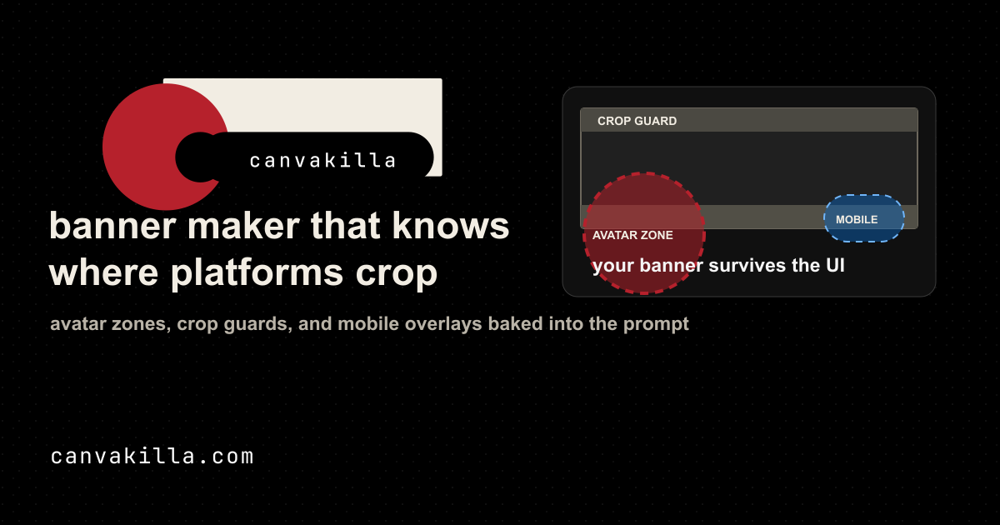

<div align="center">



# CanvaKilla

**The banner maker that knows where every platform actually crops.**

[Try it at canvakilla.com](https://canvakilla.com)

</div>

CanvaKilla makes X and LinkedIn banners and profile pictures with AI image models. Every prompt carries the platform's crop rules, so your face, logo and tagline stay clear of the avatar circle, the mobile buttons and the strips the platform trims off.

It is for anyone who has watched a banner's text vanish behind their own profile picture.

Built because Canva kept hiding banner text behind avatars, mobile follow buttons, and the 60-pixel strips X clips off the top and bottom on certain displays.

## What it does

- **X and LinkedIn.** `/x` exports a 1500x500 banner, `/linkedin` a 1584x396 banner. Both export a 1024x1024 profile picture.
- **Crop guards in every prompt.** X: avatar quiet zone (lower left), mobile action zone (lower right), 60 px top and bottom strips. LinkedIn: profile photo overlay (lower left), mobile side crops, thin top and bottom strips, and a central safe area for text.
- **Live preview.** A desktop and mobile mock of the profile page shows where the avatar, buttons and crops land on your design.
- **Reference images.** Upload images, refer to them as `R1`, `R2` in your prompt, and iterate on the current result.
- **Prompt enhancer.** Paste your bio, links or posts and it rewrites your prompt for the chosen model and platform.
- **Image models through OpenRouter:** Nano Banana 2 (default), Nano Banana Pro, GPT Image 2 and Nano Banana.
- **Proof export.** Download the image, or a proof with the crop guides drawn on.

## Run it locally

You need Node 22 and an [OpenRouter](https://openrouter.ai) API key.

```bash
git clone https://github.com/joewilsonai/canvakilla
cd canvakilla
npm ci
cp .env.example .env.local   # then set OPENROUTER_API_KEY
npm run dev
```

Open [http://localhost:3000/x](http://localhost:3000/x) or [http://localhost:3000/linkedin](http://localhost:3000/linkedin).

`OPENROUTER_API_KEY` is the only value you need to generate images. The rest of `.env.example` is optional:

| Variable | What it is for |
|---|---|
| `CANVAKILLA_SESSION_SECRET` | Signs the session cookie. Set a long random string in production. |
| `UPSTASH_REDIS_REST_URL`, `UPSTASH_REDIS_REST_TOKEN` | Shared rate limits across server instances. Without them, limits are kept in memory. |
| `GENERATION_*`, `MAX_ACTIVE_GENERATIONS` | Per-session and per-IP request and cost limits. |
| `NEXT_PUBLIC_POSTHOG_*` | Product analytics. Leave blank to turn it off. |

## Command line

The repo also ships a small CLI. By default it calls the hosted API at canvakilla.com; point it at your own server with `--base-url` or `CANVAKILLA_BASE_URL`.

```bash
npm run cli -- help
npm run cli -- enhance --platform linkedin --prompt "founder banner, premium"
npm run cli -- generate --platform x --prompt-file prompt.txt --reference logo.png --output x-banner.jpg
```

Run `npm run cli -- <command> --help` for every option.

## Development

```bash
npm run typecheck:strict   # TypeScript
npm test                   # unit tests (node --test)
npm run build              # production build
npm run test:ui            # Playwright smoke tests, run after a build
```

The UI tests start the production server, so run `npm run build` first, and install the browser once with `npx playwright install chromium`. CI runs all of these, plus `npm audit`, on every pull request and on pushes to `main`.

Built with Next.js 15, React 19 and TypeScript, hosted on Vercel.

## Status

Last updated May 2026. Checked in November 2026: `npm ci`, `npm run typecheck:strict`, `npm test` (26 tests) and `npm run build` pass on `main`, and canvakilla.com is up.

There is no licence file in this repository yet.
